<div align="center">

<a href="https://github.com/ThESLOwWoLF">
  
</a>

<a href="https://www.linkedin.com/in/sudhan-shankar-1710a529b/"></a>
<a href="mailto:sudhan1345@gmail.com"></a>


<!-- ANIME GIF: paste a GIF link you like below and uncomment the line -->
<!--  -->

</div>

---

```bash
sudhan@slowwolf:~$ whoami
final-year CSE student, Amrita Vishwa Vidyapeetham, Bengaluru (2027)

sudhan@slowwolf:~$ cat interests.txt
ml        -> models I can actually evaluate, not just train
3d vision -> LiDAR point clouds, range images, geometry
llms      -> local models, orchestration, grounding
systems   -> anything that makes me read a spec at 2 am

sudhan@slowwolf:~$ ls achievements/
ieee_paper_rl.pdf   p2p_net_lidar/   wavlm_leakage_fix/   bi0s_ctf_forensics/

sudhan@slowwolf:~$ echo $STATUS
looking for internships: ML / Applied AI / Research Engineering

sudhan@slowwolf:~$ cat fuel.log
red bull   ████████████████████  100%
sleep      ██░░░░░░░░░░░░░░░░░░   10%
```

---

## Things I've built

### P2P-Net: Zero-Shot LiDAR Super-Resolution
   

Doubles the vertical resolution of a LiDAR scan (64 to 128 beams) with **no external training data**.
Each missing beam's ray is intersected with tangent planes of its neighbours, and a tiny MLP, trained on the scan itself, picks which surface the ray actually hits.

> On 11 held-out real frames: **45% lower Chamfer distance** and **29% fewer flying points** than linear interpolation.
> Median error got slightly worse (2.20 vs 2.05 cm), and yes, I report that too.

<details>
<summary><b>The trick I'm proudest of</b></summary>

The OS1-64's beams turn out to be exactly the odd beams of the OS1-128 (checked in the sensor metadata).
So deleting the even beams from a real 128-beam scan gives a real 64-beam input, with measured ground truth on the exact same rays.
No simulation, no ICP, no guessing which point matches which.

</details>

[→ Repo](https://github.com/ThESLOwWoLF/LiDAR-Upscaling) · *v2 code landing soon*

---

### Speech Clarity Classifier on WavLM
    

Classifies viva answer recordings as low / medium / high clarity using frozen WavLM embeddings and an SVM.

> **Plot twist:** my original 0.69 macro F1 was data leakage. After grouping by recording and moving every transform inside the pipeline, the honest number is **0.46** (MFCC baseline 0.42, chance 0.33).
> Lower number, much better project.

Served with FastAPI + a Gradio demo, 32 tests, 39 ms per clip on GPU.

[→ Repo](https://github.com/ThESLOwWoLF/Clarity-Assessment-in-Viva-Answers-in-speech-signals)

---

### Multi-LLM Research Orchestrator
   

Four LLMs (Gemma 4 31B, Llama 3.3 70B, DeepSeek, local Qwen) answer the same question, critique each other, then one writes the final answer.
Runs live as background asyncio tasks, so closing the tab doesn't kill the run: reconnect and it replays everything you missed.

---

### Omni-Exec: ELF64 / PE32+ Loader
   

Loads code from a Linux ELF on Windows (and a Windows PE on Linux) and calls it through a **24-byte trampoline I hand-encoded in machine code**, swapping Microsoft x64 argument registers into System V order.
Runs small position-independent functions for now. Relocations and imports are next.

```asm
48 89 CF    mov rdi, rcx   ; arg1: Windows -> Linux
48 89 D6    mov rsi, rdx   ; arg2
4C 89 C2    mov rdx, r8    ; arg3
4C 89 C9    mov rcx, r9    ; arg4
48 B8 ...   movabs rax, <target>
FF E0       jmp rax        ; and pray
```

[→ Repo](https://github.com/ThESLOwWoLF/ABI-Translator-for-Linux-Windows)

---

## Toolbox

**Languages**
   

**ML**
       

**LLMs**
 

**Backend & tools**
    

---

## git log --oneline (lessons learned)

```text
f3a91c2  fix(wavlm): 0.69 F1 was leakage. honest score is 0.46. growth.
b7e04d1  feat(lidar): read the sensor metadata. found a free benchmark in it.
9c2d6aa  feat(omni-exec): learned what 48 89 CF means. cannot unlearn it.
4e18f07  chore: stopped trusting any number I can't reproduce
1a0b3e9  init: "it's just one quick project"
```

---

## Currently

- Rebuilding my English-to-KQL project around a local LLM, with a real KQL parser in the loop
- Testing whether four LLMs arguing actually beats the best single one
- Pushing P2P-Net v2 to GitHub
- Deep Learning Specialisation (DeepLearning.AI)

---

<div align="center">




*If you read this far, we should probably talk.*

 
</div>
